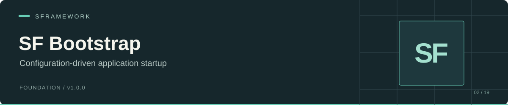

# SF Bootstrap

 

SF Bootstrap runs an ordered list of asynchronous startup steps stored in Unity ScriptableObject assets. Use it when a project needs configurable startup sequences, per-platform configuration, step messages, and elapsed-time reporting.

Your project supplies the bootstrap component and concrete step assets. The package supplies the runner, configuration types, and lifecycle hooks.

[Installation](#installation) · [Setup](#setup) · [Example](#example) · [API](#api) · [Runtime behavior](#runtime-behavior) · [Repository map](#repository-map)

## Installation

In Unity Package Manager, choose **Add package from git URL**:

```text
https://github.com/huran438/sf-bootstrap.git#main
```

Alternatively, add this entry to `Packages/manifest.json` inside `dependencies`:

```json
"sp.sframework.bootstrap": "https://github.com/huran438/sf-bootstrap.git#main"
```

The [manifest](package.json) declares no dependency entries or minimum Unity version. The [runtime assembly](Runtime/SFramework.Bootstrap.Runtime.asmdef) references `UniTask` and `SFramework.Core.Runtime`, so install UniTask and [SF Core](https://github.com/huran438/sf-core) in the host project, along with Core's dependencies. A custom application assembly must reference `SFramework.Bootstrap.Runtime` and `UniTask` to compile the examples. Check compatibility with your editor; package metadata does not confirm it.

## Setup

1. Create a `SFBootstrapStepData` subclass for each startup operation.
2. Create its assets through your subclass's `CreateAssetMenu` entry.
3. Create a config through **Assets → Create → SFramework → Bootstrap → Config**.
4. Add step entries in the required order, assign each asset to **Data**, and enable the entries you want to run.
5. Create a `SFBootstrap` subclass, add it to a scene GameObject, and assign the config to **Fallback**.
6. Add optional **Configs** entries for bundle/platform selection. Set each platform override array to an empty list when you need no overrides.

The runner calls `PreInit`, awaits each enabled step in asset-array order, then calls `Init`. It passes a cancellation token and elapsed milliseconds from bootstrap start into each hook. The bootstrap owns its token source and cancels it in `OnDestroy`.

## Example

Create `LogBootstrapStep.cs`:

```csharp
using System;
using System.Threading;
using Cysharp.Threading.Tasks;
using SFramework.Bootstrap.Runtime;
using UnityEngine;

[CreateAssetMenu(menuName = "Example/Bootstrap/Log Step")]
public sealed class LogBootstrapStep : SFBootstrapStepData
{
    [SerializeField] private string _message = "Startup step completed";

    public override UniTask Run(
        Action<float, string> stepProgress,
        CancellationToken cancellationToken,
        long elapsedMilliseconds)
    {
        cancellationToken.ThrowIfCancellationRequested();
        UnityEngine.Debug.Log($"{_message}; started at {elapsedMilliseconds} ms");
        stepProgress(1f, _message);
        return UniTask.CompletedTask;
    }
}
```

Create `ExampleBootstrap.cs`:

```csharp
using System.Threading;
using Cysharp.Threading.Tasks;
using SFramework.Bootstrap.Runtime;
using UnityEngine;

public sealed class ExampleBootstrap : SFBootstrap
{
    protected override UniTask PreInit(
        CancellationToken cancellationToken, long elapsedMilliseconds)
    {
        cancellationToken.ThrowIfCancellationRequested();
        Progress += OnProgress;
        StepProgress += OnStepProgress;
        return UniTask.CompletedTask;
    }

    protected override UniTask Init(
        CancellationToken cancellationToken, long elapsedMilliseconds)
    {
        cancellationToken.ThrowIfCancellationRequested();
        UnityEngine.Debug.Log($"Bootstrap finished after {elapsedMilliseconds} ms");
        return UniTask.CompletedTask;
    }

    private void OnProgress(float progress, long stepMilliseconds)
    {
        UnityEngine.Debug.Log($"Step timing: {stepMilliseconds} ms; progress: {progress}");
    }

    private void OnStepProgress(float progress, string message)
    {
        UnityEngine.Debug.Log($"{message}: {progress}");
    }

    protected override void Dispose()
    {
        Progress -= OnProgress;
        StepProgress -= OnStepProgress;
    }
}
```

Create one Log Step asset and a bootstrap config containing an enabled reference to it. Add `ExampleBootstrap` to the scene and assign that config as its fallback. For an asynchronous operation, await it inside `Run` and pass the provided cancellation token to operations that support cancellation.

## API

Types use the `SFramework.Bootstrap.Runtime` namespace.

| API | Contract |
| --- | --- |
| `SFBootstrap.PreInit(CancellationToken, long)` | Abstract `UniTask` hook before the step list. |
| `SFBootstrap.Init(CancellationToken, long)` | Abstract `UniTask` hook after the step list. |
| `SFBootstrap.Dispose()` | Abstract cleanup hook called by the base `OnDestroy`. |
| `Progress` | Protected `Action<float, long>` event: overall fraction and just-finished step duration. |
| `StepProgress` | Protected `Action<float, string>` event that steps can invoke through their callback. |
| `SFBootstrapStepData.Run(Action<float, string>, CancellationToken, long)` | Abstract async operation implemented by a project step asset. |
| `SFBootstrapConfigData.Name`, `Steps` | Config display name and ordered step array. `Name` falls back to the Unity asset name. |
| `SFBootstrapStep.Enabled`, `Data`, `Name` | Entry metadata. `Enabled` requires both its checkbox and a non-null asset. |
| `SFBootstrapConfig.BundleId`, `Data` | Bundle selection plus config data selected by current `Application.platform`. |
| `SFBootstrapConfigByPlatform.Platform`, `Data` | One platform override. |

## Runtime behavior

- On mobile, the runner selects the first config whose `BundleId` equals `Application.identifier`. On other platforms, it selects the first config entry without checking its bundle ID. With no eligible entry, it uses **Fallback**.
- Within a selected entry, `Data` chooses the first override matching `Application.platform`, then the entry's base data. An eligible entry with null data replaces the fallback with null; the runner does not try later entries.
- The runner skips disabled steps and null step assets. It invokes `Progress` only after an enabled step finishes.
- The overall fraction uses `index / Steps.Length`, with a zero-based original-array index. A single enabled step reports `0`; the final step does not report `1`. Disabled entries still contribute to the denominator. Use the final `Init` hook to mark completion in your UI.
- A step receives total elapsed time at its start. The `Progress` duration measures that step alone. The runner stops its total stopwatch before the final `Init`, so that hook's duration is outside the reported total.
- Steps must observe the token to stop their work. The runner supplies no retry, timeout, exception recovery, or public completion task. An exception interrupts the remaining sequence.
- If no config exists, `Awake` logs an error and returns before creating the stopwatch and token source. The current `OnDestroy` still dereferences both fields. Supply a valid config before running the component.
- If you override `Awake` or `OnDestroy`, preserve the base lifecycle. Initialize platform override arrays; `SFBootstrapConfig.Data` iterates them without a null guard.

For missing-step execution, check the entry's enabled checkbox and asset reference. For unexpected config selection, check the mobile bundle rule and the order of config entries. The bootstrap assembly references Core, but its own source does not call `SFContainer`; service registration and initialization belong in your project hooks or step assets.

## Repository map

| Source | Responsibility |
| --- | --- |
| [Runtime/SFBootstrap.cs](Runtime/SFBootstrap.cs) | Runner, progress events, token lifetime, timing. |
| [Runtime/SFBootstrapConfigData.cs](Runtime/SFBootstrapConfigData.cs) | Config ScriptableObject and ordered steps. |
| [Runtime/SFBootstrapStepData.cs](Runtime/SFBootstrapStepData.cs) | Custom step contract. |
| [Runtime/SFBootstrapStep.cs](Runtime/SFBootstrapStep.cs) | Enabled state and per-entry metadata. |
| [Runtime/SFBootstrapConfig.cs](Runtime/SFBootstrapConfig.cs) | Bundle and platform selection. |
| [package.json](package.json), [Runtime/SFramework.Bootstrap.Runtime.asmdef](Runtime/SFramework.Bootstrap.Runtime.asmdef) | Package identity and assembly requirements. |

## Related modules, validation, and license

See [SF Core](https://github.com/huran438/sf-core) for service registration and initialization, and [SF Debug](https://github.com/huran438/sf-debug) for a gated Unity logging facade.

This README describes source snapshot `ad8dc0e7e12ab41f1812d00735f97c9fe7e352ac`. The examples were inspected statically against the source; they were not compiled or executed in Unity. Verify the scene configuration and cancellation behavior in the host project.

MIT License. See [LICENSE.md](LICENSE.md).
